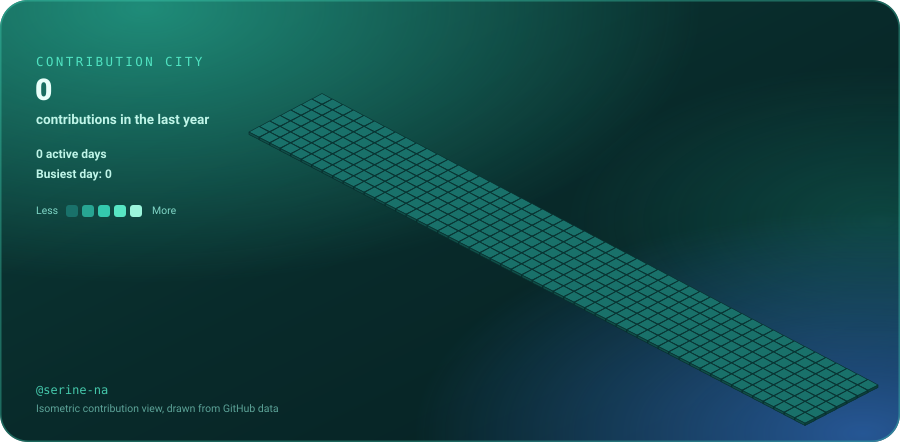
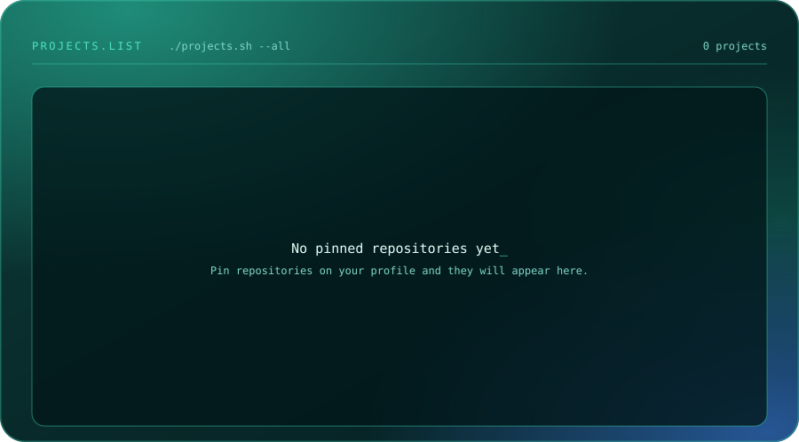

<!--
  Layout, top to bottom:
  hero → "The city I built this year" → "Population" → "Landmarks" → "Visit" → footer
  All graphics are original SVGs in ./assets, drawn by generate.py from GitHub's own API.
  Replace YOUR_GITHUB_USERNAME and YOUR_NAME (see SETUP.md).
-->

## The city I built this year

Every building is a day; taller means more contributions.

## Population

## Landmarks

## Visit

<a href="https://github.com/YOUR_GITHUB_USERNAME">GitHub</a>

YOUR_NAME · Contribution city drawn from GitHub data

